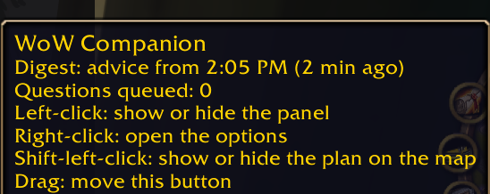
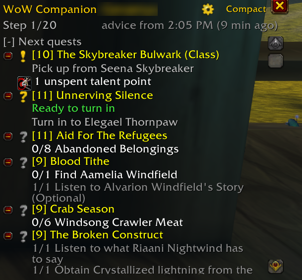
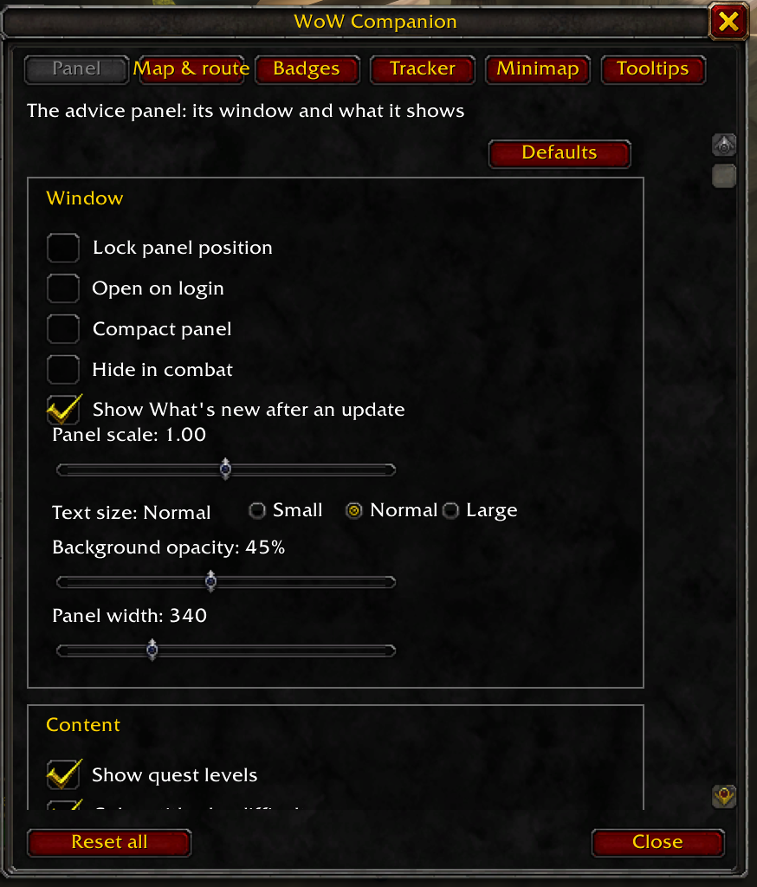
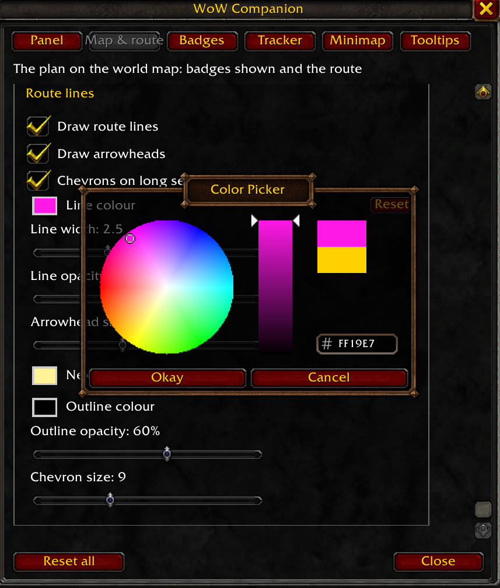

# WoW Companion addon

The WoW Companion addon puts your personal plan inside World of Warcraft. It draws your next steps as
numbered stops on your map, with a route between them.

<!-- screenshot: map-plan.png — the world map with a numbered plan and route, and the plan list open beside it -->

You'll need the free WoW Companion app too → [Getting Started](https://github.com/WoW-Companion/advisor/blob/main/docs/getting-started.md)

The addon only shows things. It never plays the game for you, and everything in it is optional to use.

## Works with the WoW Companion app

The app is the main experience. This addon is the in-game extra. Two pieces work together:

- **The WoW Companion addon** (this one) writes down what your character has: level, quests, bags, bank,
  gear, talents and recipes, using only the game's read-only information. Until the app version that reads this
  capture is out, ForeverScribe (another addon) still works, and having both is fine. Once that version is out,
  ForeverScribe is no longer needed. You can turn the recording off in the options. The format is in
  [docs/capture-format.md](docs/capture-format.md).
- **The WoW Companion app** runs in a window beside the game. It reads what your character has and works
  out your next steps and the best route. Then it hands the advice to the addon.
- The same addon also shows that advice in the game: the plan on your map, the panel and the
  minimap button.

<!-- screenshot: overlay-beside-game.png — the game with the WoW Companion app beside it -->

**The loop:** play, then type `/reload`. The game saves, and the app writes fresh advice within seconds.
Type `/reload` again to see it.

Without the app, the addon shows only live quest progress. There is nothing else to show yet.

## A tour of the addon

### Your plan on the map

Open your world map. You'll see a round WoW Companion button with the game's other map buttons.

- **Click the round button** to open your plan list beside the map, like the quest log.
- **Shift-click it** to show or hide the numbered steps and the route on the map.
- **Right-click it** to open the options.
- **Shift-drag it** to move it up or down.

Hover the button and a small tooltip lists these. Hover a step in the list and its number lights up on the
map. Your steps appear as numbered gold badges, with lines between the steps still to do.

<!-- screenshot: map-route-closeup.png — the map zoomed in on a few numbered steps -->

Nothing is drawn until the app has written your plan. If you are in combat, the list opens when combat ends.

### The minimap

The minimap button shows how fresh your advice is when you hover it.

- **Left-click** shows or hides the panel.
- **Right-click** opens the options.
- **Shift-left-click** shows or hides the plan on the map.
- **Drag** it to move it around the minimap.

*The minimap button's tooltip, listing what each click does.*

The addon can also put a marker for your next step on the minimap. You can turn it off in the options.

<!-- screenshot: minimap-next-step.png — the minimap with the next-step marker -->

### The panel

Type `/wowc` to open or close the panel. Drag it to move it. It lists your next steps in sections you can
collapse.

*The panel, with your next quests and a line for the unspent talent point.*

- Hover a line and its badge lights up on the map.
- Click a quest to open it in your quest log.
- Click any other line, or right-click, to open a small card with details.
- Small chips under the header count to-dos such as talents and upgrades. Click one for details.

Some cards hold a ready-made question. Click it and press Ctrl+C to copy it. Then paste it into the app,
which answers in its own window. You never type a question in the game. If your advice looks old, the panel
says so.

### Options

Right-click the round map button or the minimap button, or type `/wowc options`. Changes apply at once, so
you never need a `/reload`.

*The options window, with one tab for each part of the addon.*

- A small **Reset** button appears next to any setting you changed. It puts that one setting back.
- **Reset all** at the bottom restores every setting.

*Picking a new colour for the route lines.*

Hover an item or quest in the game's own tooltips. If it is one of your upgrades or next steps, the addon
adds a gold "WoW Companion" line. You can turn that off in the options.

## Install

1. Download the latest `WoWCompanion-<version>.zip` from the
   [Releases](https://github.com/WoW-Companion/addon/releases) page. You'll have a zip file.
2. Unzip it into your game's `Interface\AddOns` folder. You'll see two new folders, `WoWCompanion` and
   `WoWCompanion_Digest`, side by side.
3. Fully quit the game and start it again. You'll see WoW Companion in the addon list at character select.

The game only finds new addon folders when it starts. After an update that adds no new folder, `/reload` is
enough.

To update, delete the old `WoWCompanion` folder, unzip the new release, then restart the game.
Your advice is safe: the zip never includes the file the app writes it to, so unzipping never overwrites it.

## Slash commands

| Command | What it does |
| --- | --- |
| `/wowc` | Show or hide the panel |
| `/wowc options` | Open the options window (`/wowc settings` and `/wowc config` do the same) |
| `/wowc plan …` | Show or hide the next-step line; `map`, `lines` and `arrows` toggle the badges, route lines and arrowheads; `size small\|normal\|large` sets the badge size |
| `/wowc reset visuals` | Put every colour, opacity and size back to its default (asks first) |
| `/wowc reset all` | Put every setting back to its default; saved positions stay (asks first) |

`/wowc status` shows versions and how old your advice is. `/wowc help` lists everything, including
`/wowc reset`, which restores the panel position.

## Read-only promise

This addon only reads game state and shows it. It never casts spells, uses items or sends chat, whispers or
mail. It never buys, sells, posts or bids. It never presses keys or moves your character, and it sends
nothing out of the game. It only reloads the game when you type a command that asks for it. A test scans the
addon's code for forbidden actions and fails the build if it finds one.

## For developers

`make verify` runs the read-only guard and the tests with `luajit` against a stubbed client API
(`tests/wow_stub.lua`); the game is not needed. `make package` builds the release zip.

- Digest file format: `docs/digest-format.md`. Ask queue format: `docs/ask-format.md`.
- The app writes `WoWCompanion_Digest/Digest.lua` (the digest) and, with advisor 0.6.0 or later,
  `WoWCompanion_Digest/Plan.lua` (the route). Both are data-only; the plan refreshes at the next `/reload`.
  The zip never contains `Digest.lua`; until the app writes it, the addon treats it as empty.
- `tests/guard.lua` scans the addon's Lua for forbidden calls. `ReloadUI` is only called as the direct
  result of a player's slash command.
- Upgrading from 0.1.x: the in-game Ask box, History and the `WoWCompanion_Answers` folder are gone. A
  leftover folder is harmless; the addon never deletes your files.

## License

MIT, see `LICENSE`. Copyright (c) 2026 WoW Companion contributors.

WoW Companion is a fan project. It is not affiliated with or endorsed by Blizzard Entertainment. World of Warcraft and Warcraft are trademarks of Blizzard Entertainment, Inc.
